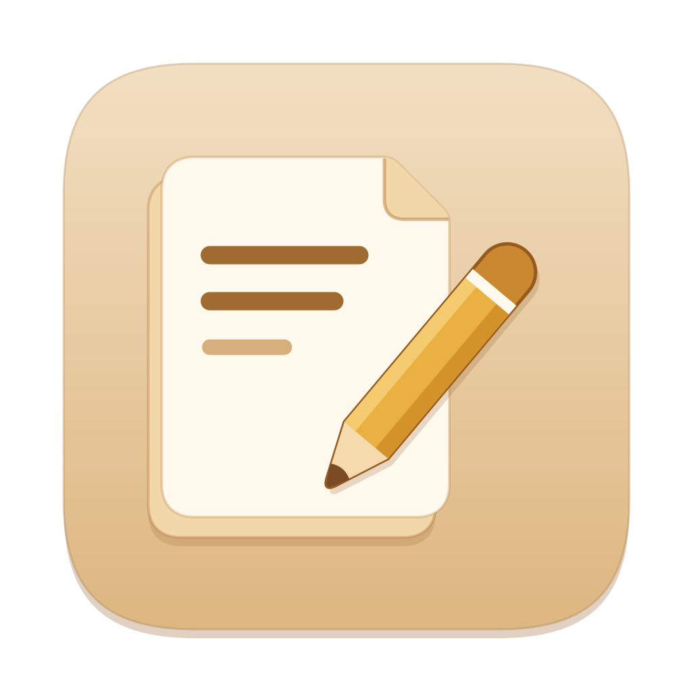
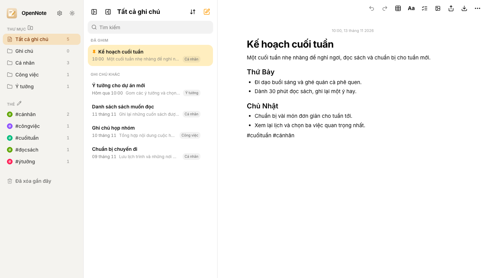

# OpenNote





OpenNote là ứng dụng ghi chú cá nhân dùng giao diện tiếng Việt. Ứng dụng chạy trên máy của bạn và lưu dữ liệu trong SQLite.

- Soạn ghi chú có định dạng, chèn ảnh, bảng và danh sách công việc.
- Sắp xếp theo thư mục, ghim ghi chú, dùng hashtag và tìm kiếm.
- Khóa ghi chú bằng PIN, khôi phục ghi chú từ thùng rác và hoàn tác thao tác xóa vĩnh viễn trong phiên đang dùng.
- Sao lưu và nhập JSON, xuất văn bản hoặc Markdown.

## Chạy từ mã nguồn

Các bước dưới đây dùng macOS Apple Silicon, Bun 1.3.14, Node.js và `sqlite3`. Bản 0.2.3 được kiểm tra với Node.js 26.10.0. Chạy các lệnh sau trong một bản clone mới để tạo SQLite trống.

```sh
git clone https://github.com/teakay1311/OpenNote.git
cd OpenNote
bun install --frozen-lockfile
bash scripts/macos/install-native.sh
mkdir -p db
cp .env.example .env
bun run db:generate
(
  set -e
  test ! -e db/custom.db
  schema_sql="$(bun run prisma migrate diff --from-empty --to-schema-datamodel prisma/schema.prisma --script)"
  printf '%s\n' "$schema_sql" | sqlite3 -bail db/custom.db
)
bun run next dev --hostname 127.0.0.1 --port 3000
```

Mở trình duyệt tại `http://127.0.0.1:3000`. Cấu hình mẫu lưu SQLite phát triển tại `db/custom.db`.

## Tạo bản cài macOS

Cần Xcode hoặc Xcode Command Line Tools. Từ thư mục dự án, chạy lệnh sau.

```sh
bun run package:mac
```

Thư mục `dist/` chứa bản cài `OpenNote-<phiên-bản>-macos-arm64.dmg`, checksum SHA-256 và các tệp icon. Mở ảnh đĩa, kéo OpenNote vào Applications rồi mở app. App sẽ mở trình duyệt mặc định tại `http://127.0.0.1:16347`. Bản build dùng chữ ký ad-hoc cho máy tạo bản cài.

## Dữ liệu và nâng cấp

Bản cài macOS lưu dữ liệu tại `~/Library/Application Support/OpenNote/custom.db`. Để chuyển SQLite từ bản cũ, hãy lưu và đóng ứng dụng cũ, sau đó làm theo mục chuyển dữ liệu trước khi mở bản cài lần đầu. Công cụ chuyển tạo và kiểm tra bản sao SQLite trước khi đặt dữ liệu vào thư mục đích. [Hướng dẫn cài và chuyển dữ liệu](scripts/macos/INSTALL.md)

Bản sao JSON bỏ nội dung và PIN của ghi chú khóa. Dùng bản sao SQLite để giữ các dữ liệu này khi chuyển máy hoặc nâng cấp.

## Giấy phép

OpenNote sử dụng Apache License 2.0. Các thành phần giao diện lấy từ shadcn/ui giữ giấy phép MIT. [Apache License 2.0](LICENSE) · [Thông báo bên thứ ba](NOTICE)
